# SpyroEngine — Spyro 1, 2 and 3

A native PC port of the PlayStation Spyro trilogy: Spyro the Dragon, Spyro 2: Ripto's Rage! and
Spyro: Year of the Dragon. One program opens on an in-window title picker and runs any of the three
from your own discs. It adds widescreen that draws more of the world, 60 fps by interpolation over
the original 30 fps logic, and Start/Cross skips for logos, fades and transitions.

Work in progress: every title reaches gameplay, but none is complete. Status per feature is in
[`docs/project-state.md`](docs/project-state.md).

## Screenshots

Captured from the port at 16:9 with 60 fps interpolation on.

### Spyro the Dragon

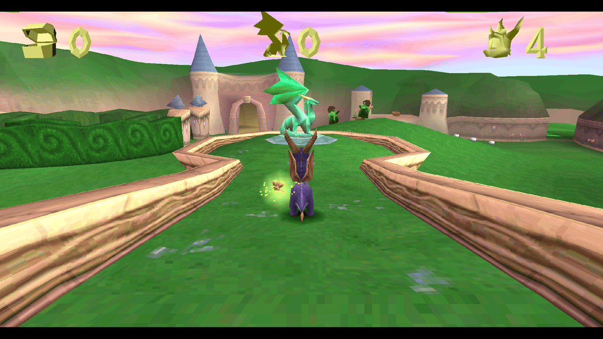
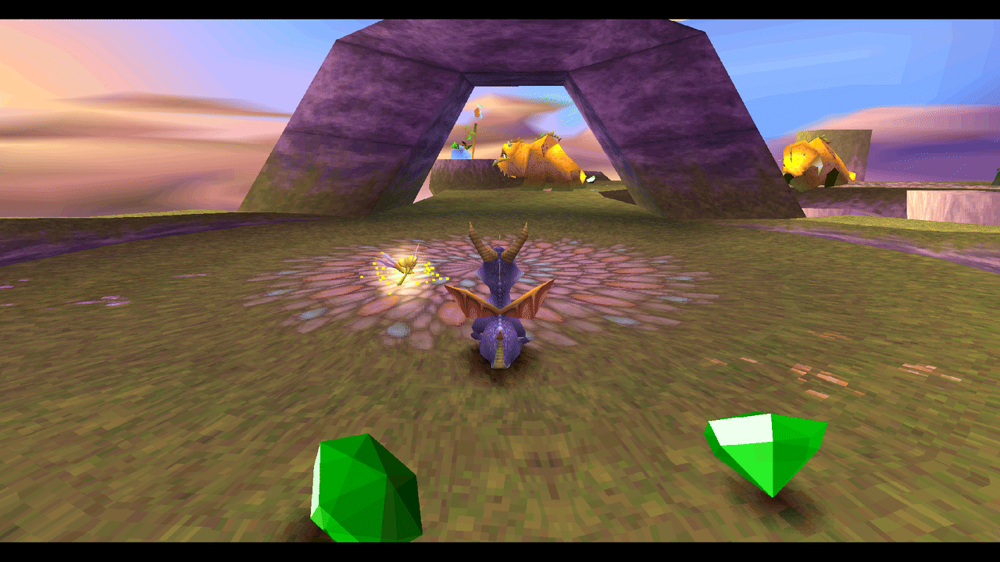
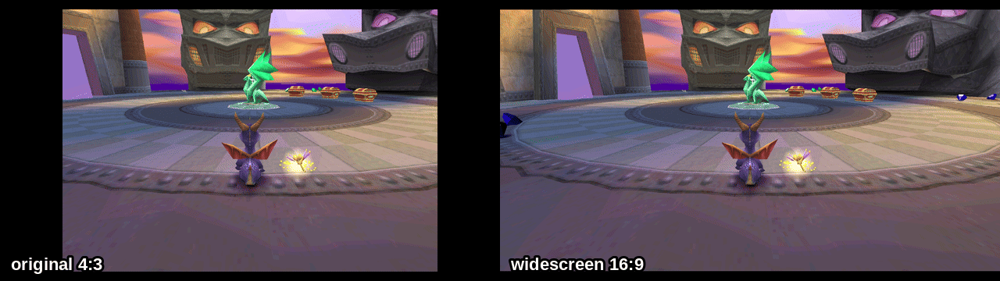
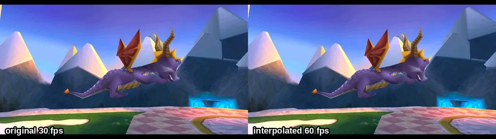

*The title-screen flyby at quarter speed: the original (left) changes every other frame; the
interpolated side (right) changes every frame, halfway between.*

### Spyro 2: Ripto's Rage!

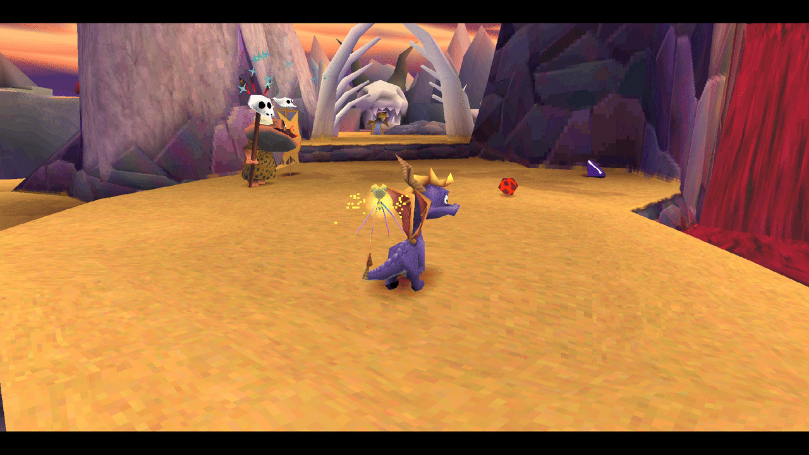
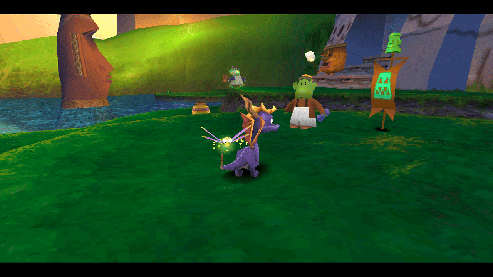
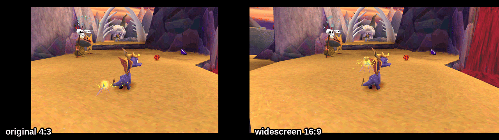
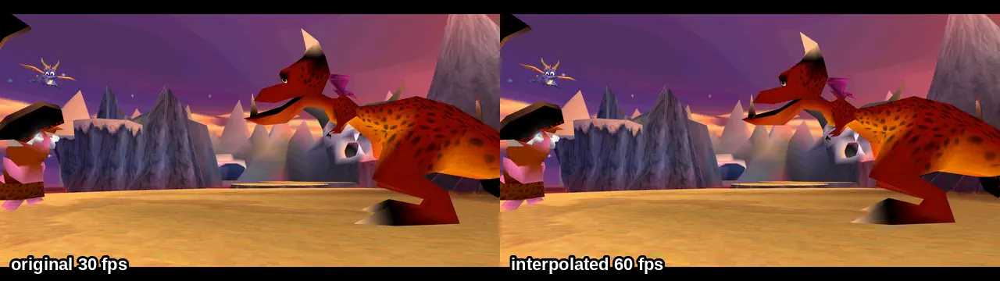

*The intro at quarter speed, original left, interpolated right.*

### Spyro: Year of the Dragon

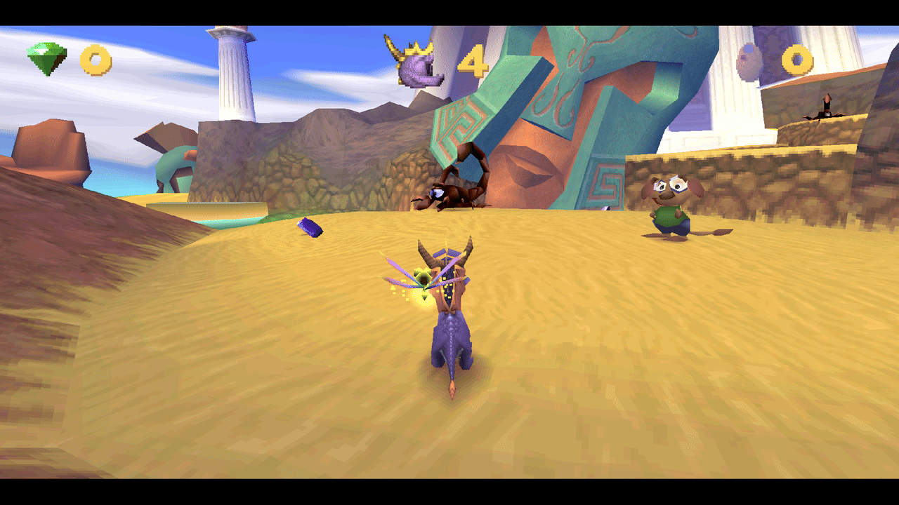
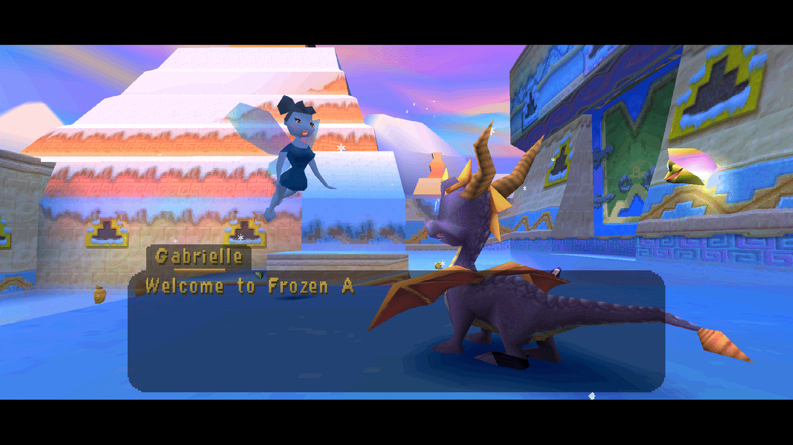
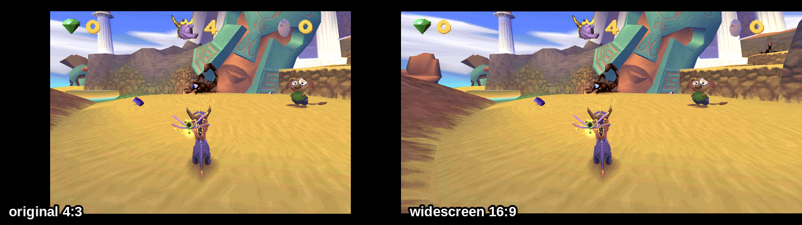
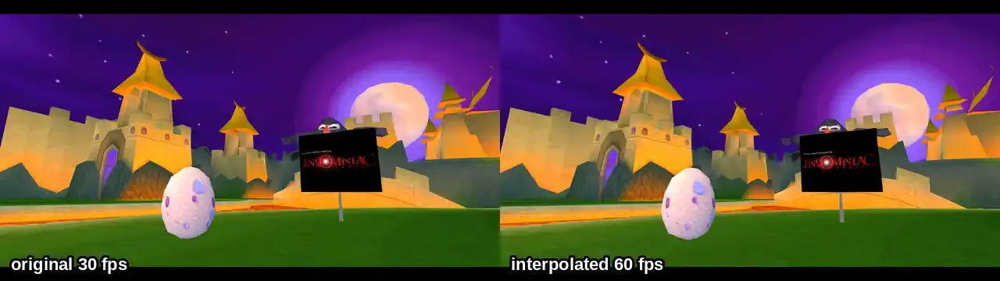

*The Insomniac intro at quarter speed, original left, interpolated right.*

## Features

- **Widescreen (16:9, 21:9).** The game's own culls are widened, so the extra columns show terrain,
  objects and sky the 4:3 view leaves out; the HUD sits at the wide edges. Nothing is stretched.
- **60 fps.** The logic keeps its original rate; each in-between frame is the game's own draw code
  run again with the moving state blended halfway, inside a sandbox that undoes its writes.
- **Start/Cross skips** for logos, fade-outs, Exit Level fades, portal flights and the skies after
  them, each ending through the game's own transition.
- **Loading** without drive-time waits.
- **Crop widescreen** (experimental): the world fills the wide screen as a band of the 4:3 picture
  while HUD and menus stay whole.
- **Internal resolution** up to 8x, and a title picker that can return to the picker and start
  another title in the same process.

## Running

No game code, asset, executable, disc image or BIOS is distributed. Supply your own discs: copy
`.env.example` to `.env` and point it at your disc images (or drop a `.chd` in the repository root).

```sh
./run.sh
```

`run.sh` sets up the locked Python environment, fetches the psxport framework when it is missing,
builds the product and launches it. It needs CMake, Ninja and a C++ compiler (GCC, Clang or
AppleClang); a missing dependency is refused with the install command for your platform. Linux is the
supported host today; Windows, macOS and Android builds are not released yet.

A supplied executable selects its title by serial, PS-X EXE header, size and hash: `SCUS_942.28`
(Spyro the Dragon), `SCUS_944.25` (Spyro 2) and `SCUS_944.67` (Spyro 3).

## How it works

The port is a native/dynamic-recompiler hybrid built on
[psxport](https://github.com/SomeoneIsWorking/psxport). Native C++ replaces the parts of each game
that the port owns (frame loop, drawing culls, CD loading, HUD placement), and every other MIPS
instruction is translated at run time by Lightrec from your own game files. Nothing is translated
offline and no guest code is shipped.

`game/` holds what the three titles share; `titles/<title>/` holds each title's identity, frame
driver and overrides. [`docs/codemap.md`](docs/codemap.md) maps every module,
[`docs/features.md`](docs/features.md) the feature chains, and
[`docs/project-goals.md`](docs/project-goals.md) the goals.

## Legal

psxport's vendored beetle-psx backend is GPL-2.0. Spyro is a trademark of its respective rights
holders. This project is not affiliated with or endorsed by them.

Built with AI assistance (Claude and other LLMs).
